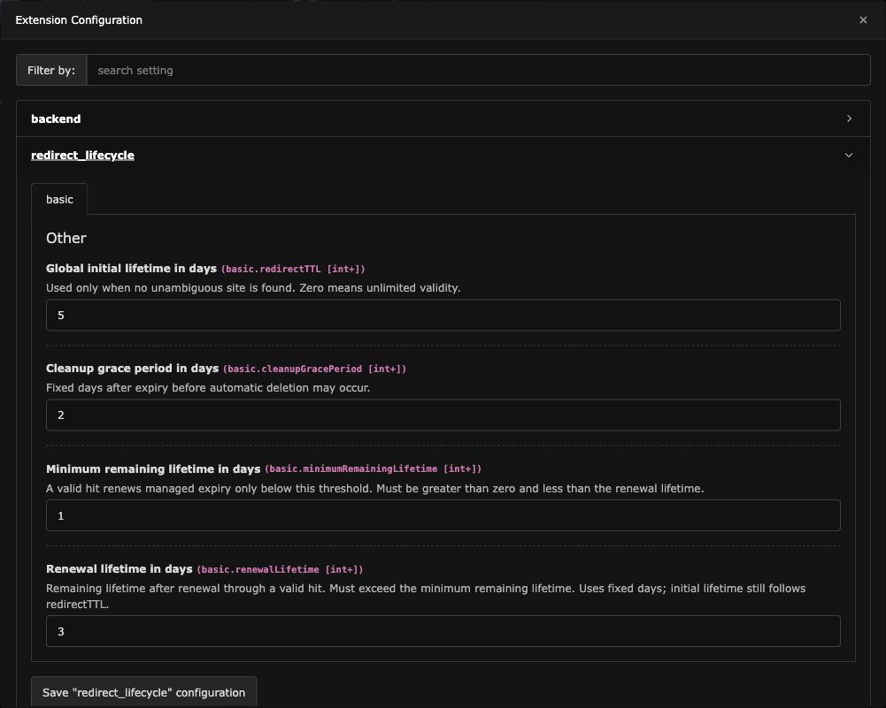
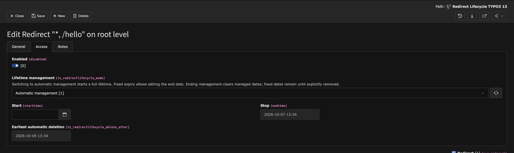
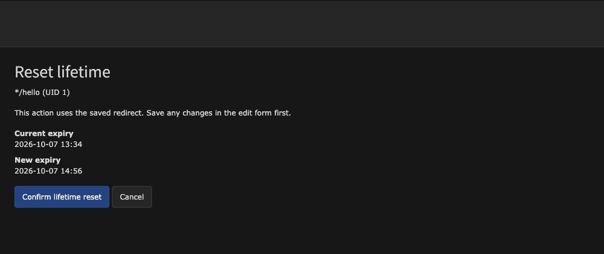

# Redirect Lifecycle

Keep used redirects alive and remove expired ones after a grace period.
Redirect Lifecycle adds automatic lifetime management to TYPO3's native redirects,
with a fixed-expiry option and a backend action to start a fresh lifetime.

Supports TYPO3 **12.4, 13.4, and 14**. Requires PHP **8.1+**, EXT:redirects,
and EXT:scheduler. This extension is currently a development alpha.

## Installation
```
composer require plan2net/redirect-lifecycle:dev-main
```

Existing redirects keep their current behavior. Installation does not enroll them
in automatic management or activate a cleanup task.

## Configure the lifetime

Set the initial lifetime through TYPO3's site configuration (`config/sites/<site>/config.yaml`):

```yaml
redirects:
  redirectTTL: 180
```

The site's `redirectTTL` determines the lifetime of new managed redirects and
explicit lifetime resets. **Zero means unlimited validity.** If a redirect cannot
be assigned to one site, or its site TTL is missing or `null`, the extension's
global `redirectTTL` is used instead. An explicit site TTL of `0` remains unlimited.

In **Admin Tools → Settings → Extension Configuration → redirect_lifecycle**,
configure the installation-wide settings:



The screenshot shows local example values; the defaults are listed below.

| Setting | Default | Purpose |
| --- | --- | --- |
| `redirectTTL` | `0` | Initial lifetime in days when no unambiguous site is found or its TTL is missing or `null`. |
| `minimumRemainingLifetime` | `90` | Renew on a valid hit only below this many remaining days. |
| `renewalLifetime` | `180` | Remaining lifetime in days after hit renewal; must exceed the minimum. |
| `cleanupGracePeriod` | `90` | Days after expiry before scheduled deletion is allowed. |
| `disabledRetentionDays` | `0` | Retention after disabling, in days. Zero excludes disabled redirects from cleanup. |

Initial lifetimes follow Core calendar days. Hit renewal and cleanup grace use
fixed 24-hour days. Changing settings leaves existing dates unchanged until a
lifetime action uses the new values.

## Manage a redirect in the backend

1. Open **Site Management → Redirects** and create or edit a redirect.
2. Open the **Access** tab.
3. Select **Lifetime management**, then save the record.



| Mode | Behavior |
| --- | --- |
| **Automatic management** | Starts a lifetime using the current TTL. Expiry and earliest deletion are read-only; valid hits can extend them. |
| **Fixed expiry time** | Lets you edit the native Stop date. No automatic renewal; cleanup can soft-delete the redirect after expiry and the configured grace period. |
| **No automatic management** | Ends management and clears managed dates. An existing fixed expiry remains until explicitly removed. |

New normal redirects without a fixed expiry use automatic management, including
redirects created after a page URL changes. On TYPO3 14, QR codes and short URLs
are excluded.

The Core **Protected** switch pauses management and clears managed dates.
Removing protection starts a fresh lifetime for managed redirects. Manually
disabling a redirect prevents hit renewal. Optional disabled retention can later
soft-delete it; re-enabling a managed redirect restarts its lifetime. Editors need the normal TYPO3 field permission
for **Lifetime management**.

### TYPO3 14 list features

TYPO3 14 adds these conveniences to **Site Management → Redirects**:

- A badge beside each source path shows the lifetime management mode.
- The **Lifetime management** filter offers all redirects, automatic management,
  fixed expiry, or no automatic management. It combines with the Core filters
  and applies across all pages. Select **All** or reset the filters to clear it.

Protected redirects remain in the automatic-management category when enrolled;
the Core's **Protected** column shows that management is paused. TYPO3 12/13
retain the lifetime selector in the edit form, with the same lifecycle behavior,
but have neither list badges nor this filter.

### Reset a lifetime

To give a managed redirect a fresh initial lifetime:

1. Save any changes in the edit form.
2. Click **Reset lifetime** beside the lifetime selector.
3. Review the current and proposed expiry, then confirm.



A reset uses the current site TTL or global fallback and replaces both dates.
It can shorten a lifetime; the preview warns when that happens. Protected
redirects and redirects with TTL zero receive no managed dates.

### Renewal through visitors

No editor action is needed for hit renewal. With the defaults, a valid request
with **less than 90 days** remaining renews the redirect to **180 days** from
that request. Further hits at or above the threshold leave the dates unchanged.
Hit counting may be disabled; renewal still works.

A hit never shortens expiry or the stored deletion time. Expired redirects no
longer execute and cannot renew themselves through visitors.

## Adopt existing redirects

Preview existing unmanaged redirects before enrolling them:

```sh
vendor/bin/typo3 redirect-lifecycle:adopt
vendor/bin/typo3 redirect-lifecycle:adopt 100 101 --execute
```

Only active, unprotected normal redirects without an expiry are eligible.
Omitting UIDs with `--execute` adopts all eligible redirects. Already managed
redirects keep their dates.

On all supported TYPO3 versions, `adopt --execute` also marks unmanaged normal
redirects with an existing expiry as **Fixed expiry time**. This includes expired,
protected, and disabled records. Their expiry and activation flags are preserved;
they are not enrolled in automatic management. Preview lists these records as
**Mark as fixed expiry** and leaves them unchanged.

To adopt redirects once from the backend, add a **Scheduler** task:

- **TYPO3 12/13:** choose **Execute console commands**, then `redirect-lifecycle:adopt`.
- **TYPO3 14:** choose the `redirect-lifecycle:adopt` task directly.

Select **Single execution**, set the execution time, and enable **execute** to
apply adoption. Leave **uids** empty to adopt all eligible redirects. Save and
run the task from the Scheduler. Without **execute**, it only previews candidates.

For an explicit lifetime reset from the command line:

```sh
vendor/bin/typo3 redirect-lifecycle:renew 100
vendor/bin/typo3 redirect-lifecycle:renew 100 --execute
```

Both commands preview by default and write only with `--execute`.

## Schedule cleanup

First inspect the candidates:

```sh
vendor/bin/typo3 redirect-lifecycle:cleanup --dry-run
```

To delete due redirects, run:

```sh
vendor/bin/typo3 redirect-lifecycle:cleanup
```

Cleanup soft-deletes enabled, unprotected normal redirects only after expiry
and their grace period:

- Managed redirects use their stored deletion time.
- Fixed-expiry redirects and legacy unmanaged redirects with an expiry use
  expiry plus the **current** global `cleanupGracePeriod`. They never renew
  automatically. Changing the grace setting changes when these records become due.

Short URLs, QR codes, and protected records are always excluded. Disabled records
are excluded by default; the optional policy below uses a separate countdown.
`--dry-run` lists all due candidates with their effective deletion
times and leaves records unchanged.

Deletion uses TYPO3 DataHandler and retains records and history for restoration.
Restoring a managed redirect starts a new managed lifetime; fixed and legacy
expiries retain their dates. Permanent deletion remains the Recycler's responsibility.

For a daily run, add a Scheduler task with an interval of **86400 seconds**:

- **TYPO3 12/13:** choose **Execute console commands**, then `redirect-lifecycle:cleanup`.
- **TYPO3 14:** choose the `redirect-lifecycle:cleanup` task directly.

No task is enabled automatically. Review overlapping cleanup jobs: Core's
`redirects:cleanup` does not follow this extension's grace periods and exclusions.
Before production use, verify behavior with your database, cache, and locking setup.

### Optional retention for disabled redirects

Set **disabledRetentionDays** to a positive number to retain unprotected disabled
normal redirects for that many fixed 24-hour days before soft deletion. The
default **0** excludes disabled redirects from cleanup, including existing countdowns.

Newly disabled records get a deadline immediately, even without an expiry. To
initialize existing disabled records from the current time, preview and execute:

```sh
vendor/bin/typo3 redirect-lifecycle:adopt
vendor/bin/typo3 redirect-lifecycle:adopt --execute
```

The command shows **Start disabled retention** for uninitialized records. It
preserves the disabled flag and expiry. Ordinary lifetime modes remain unchanged;
legacy records with an expiry are still classified as fixed, as described above.
Repeated adoption, unrelated edits, and changing the configured period do not
restart an initialized countdown. Existing expiry-based deletion dates are never
mistaken for disabled countdowns.

Protected disabled records remain protected and receive no countdown. Adding
protection cancels a countdown; explicitly removing protection while the record
is still disabled starts a fresh one. Adoption never removes protection.

Re-enabling cancels the disabled deadline: managed redirects start a full lifetime,
while fixed expiries retain their date. Restoring a record with initialized disabled
retention grants a fresh window without enabling it. The **Access** tab shows initialized
deadlines as read-only **Earliest automatic deletion** values. Final deletion
remains the Recycler's responsibility.

## Use with Sluggi

[wazum/sluggi](https://github.com/wazum/sluggi) is recommended and optional.
Title synchronization, manual slug changes, and descendant updates create
managed redirects through TYPO3's native events. Sluggi's decision to suppress
redirect creation remains effective. Its URL lock is separate from a redirect's
**Protected** switch.

Integration tests cover Sluggi 14.x on all three development setups.
Known upstream Sluggi deprecations on TYPO3 14 are handled by a narrow test
baseline; see [Sluggi integration](Documentation/development.md#sluggi-integration).

## Development

See the [local development guide](Documentation/development.md) for DDEV setup
and the functional tests, which use disposable SQLite databases.
